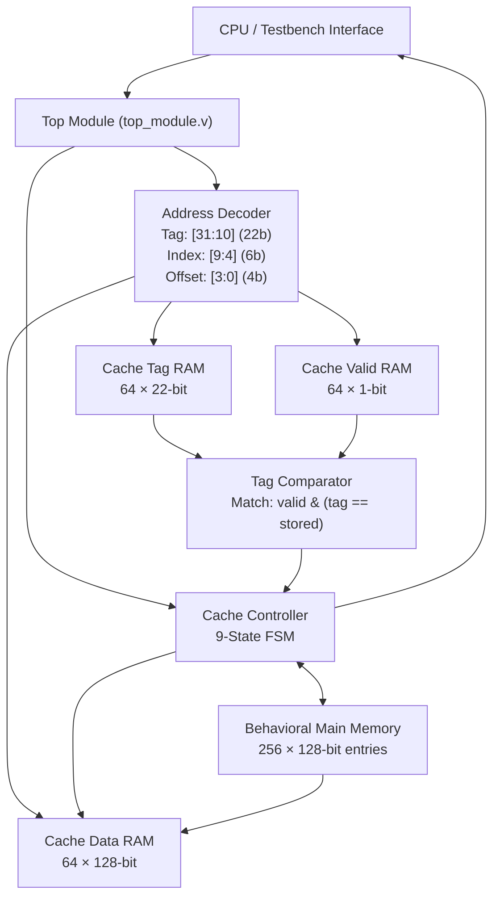
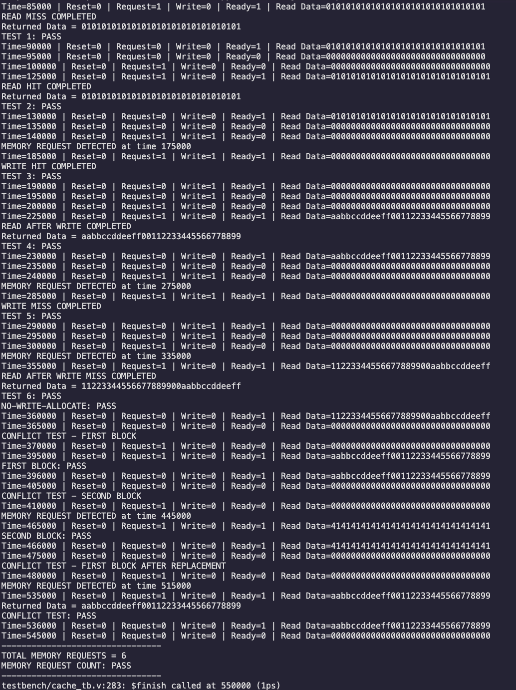

# Direct-Mapped Cache Controller Using Verilog HDL

A Verilog HDL implementation of a 1 KB Direct-Mapped Cache Controller featuring a nine-state Finite State Machine (FSM), write-through policy, no-write-allocate policy, and functional verification using Icarus Verilog.

---

## Team Members

| Name | Enrollment No. | Email |
|---|---|---|
| Kavya Saraswat | 2401010220 | [kavya.saraswat2024@nst.rishihood.edu.in](mailto:kavya.saraswat2024@nst.rishihood.edu.in) |
| Rahul Kumar Dwivedi | 2401010368 | [rahul.dwivedi2024@nst.rishihood.edu.in](mailto:rahul.dwivedi2024@nst.rishihood.edu.in) |
| Akash Kumar Gautam | 2401010050 | [akash.gautam2024@nst.rishihood.edu.in](mailto:akash.gautam2024@nst.rishihood.edu.in) |
| Sahil Chand | 2401020104 | [sahil.chand2024@nst.rishihood.edu.in](mailto:sahil.chand2024@nst.rishihood.edu.in) |
| Harendra Chokker | 2401010179 | [harender.chhoker2024@nst.rishihood.edu.in](mailto:harender.chhoker2024@nst.rishihood.edu.in) |

**Programme:** B.Tech. Computer Science and Artificial Intelligence  
**Institution:** Rishihood University, Sonipat, Haryana, India  

---

## 1. Project Overview

This project implements a **Direct-Mapped Cache Controller** using Verilog Hardware Description Language (HDL).

A cache is a small and fast memory located between the processor and main memory. It stores frequently accessed data blocks to reduce average memory access latency.

The implemented controller manages CPU read and write requests, performs cache lookups, detects cache hits and misses, communicates with main memory, and updates cache contents when required.

### Key Features

- **1 KB direct-mapped cache** organization.
- **64 cache lines**.
- **16-byte (128-bit) block size**.
- **32-bit CPU address**.
- **22-bit tag, 6-bit index, and 4-bit block offset**.
- **Nine-state Finite State Machine (FSM)**.
- **Write-through policy** on writes.
- **No-write-allocate policy** for write misses.
- **Modular Verilog implementation** separating controller, datapath RAMs, comparator, and memory.
- **Behavioral main memory model** (256 blocks of 128 bits each).
- **Assertion-based testbench** with automated pass/fail verification and failure reporting.
- **Functional verification** covering cache hits, misses, read-after-write, and conflict replacement.

### Tools and Technologies

| Tool | Purpose |
|---|---|
| **Verilog HDL** | Hardware description and implementation |
| **Icarus Verilog (`iverilog`)** | RTL compilation and simulation |
| **VVP** | Simulation execution runtime |
| **Surfer** | Waveform visualization (`.vcd`) |
| **Make** | Build and simulation automation |
| **Antigravity IDE** | Development environment |

### Project Demonstration

A walkthrough of the simulation, waveform analysis, and FSM transitions is available here:  
▶️ [Watch Project Demonstration on Google Drive](https://drive.google.com/drive/folders/130m7BiBOCHEPMafs-8uzyc5XFlS5dqOm)

---

## 2. Cache Architecture

### 2.1 Architecture Diagram

The architecture consists of an address decoder, cache tag RAM, cache valid RAM, cache data RAM, tag comparator, cache controller, and behavioral main memory. The top module connects these components to form the complete cache system.




### 2.2 Cache Configuration

| Parameter | Specification |
|---|---|
| Cache organization | Direct-mapped |
| Total cache data capacity | 1 KB |
| Number of cache lines | 64 |
| Block size | 16 bytes |
| Data width per line | 128 bits |
| CPU address width | 32 bits |
| Tag width | 22 bits |
| Index width | 6 bits |
| Offset width | 4 bits |

Each cache line stores a 128-bit data block, a 22-bit tag, and a valid bit.

The total data capacity is calculated as:
$$\text{Total Data Capacity} = 64 \text{ lines} \times 128 \text{ bits/line} = 8192 \text{ bits} = 1024 \text{ bytes} = 1\text{ KB}$$

Tag and valid-bit storage are additional metadata and are not included in the 1 KB data capacity.

### 2.3 Address Format

The 32-bit CPU address is divided into three fields:

| Address Bits | Field | Width | Purpose |
|---|---|---:|---|
| `[31:10]` | Tag | 22 bits | Identifies the memory block |
| `[9:4]` | Index | 6 bits | Selects one of 64 cache lines |
| `[3:0]` | Offset | 4 bits | Represents the byte position within a 16-byte block |

The address decoder extracts all three fields. The offset is decoded but is not used for byte- or word-level selection because the CPU interface transfers complete 128-bit blocks. Only the tag and index participate in cache lookup.

### 2.4 Cache Hit Detection

A cache hit occurs when the selected cache line is valid and its stored tag matches the requested tag.

The hit condition is:
```verilog
cache_hit = valid_bit && (requested_tag == stored_tag);
```

If the condition is false, the controller handles the request as a cache miss.

---

## 3. Cache Operation and Write Policies

### 3.1 Read Operation

When the CPU issues a read request:
1. The controller captures the CPU address.
2. The address decoder extracts the tag, index, and offset.
3. The index selects the corresponding cache line.
4. The stored tag and valid bit are examined.
5. The requested tag is compared with the stored tag.

#### Read Hit
If the valid bit is set and the tags match, the requested 128-bit block is returned directly from the cache without accessing main memory.

#### Read Miss
If the selected line is invalid or the tags do not match:
1. The controller issues a memory read request.
2. Main memory returns the requested 128-bit block.
3. The controller stores the returned data in the selected cache line.
4. The requested tag is updated.
5. The valid bit is set to `1`.
6. The data is returned to the CPU.

### 3.2 Write-Through Policy

The design implements a **write-through** policy:
- **Write Hit:** Both the corresponding cache line and main memory are updated simultaneously.
- **Write Miss:** The write operation is sent directly to main memory.

This ensures main memory is always kept up to date with the latest written data.

### 3.3 No-Write-Allocate Policy

For a write miss, the controller uses a **no-write-allocate** policy:
- The write request is sent directly to main memory.
- The cache line is not allocated, and its data, tag, and valid bit are not modified.
- A subsequent read to the same address will result in a cache miss and fetch the data from main memory.

---

## 4. Finite State Machine Design

The cache controller uses a nine-state FSM encoded using a 4-bit state register.

| State | Encoding | Function |
|---|---:|---|
| `IDLE` | `0000` | Waits for a CPU request |
| `LOOKUP` | `0001` | Allows cache RAM lookup |
| `CHECK` | `0010` | Checks valid bit and tag match |
| `READ_REQ` | `0011` | Issues a main memory read request |
| `READ_WAIT` | `0100` | Waits for the memory response |
| `REFILL` | `0101` | Updates cache data, tag, and valid bit |
| `WRITE_REQ` | `0110` | Issues a main memory write request |
| `WRITE_WAIT` | `0111` | Waits for write completion |
| `COMPLETE` | `1000` | Signals CPU request completion |

### 4.1 FSM Operation Sequences

- **Read Hit:**  
  `IDLE` → `LOOKUP` → `CHECK` → `COMPLETE` → `IDLE`
- **Read Miss:**  
  `IDLE` → `LOOKUP` → `CHECK` → `READ_REQ` → `READ_WAIT` → `REFILL` → `COMPLETE` → `IDLE`
- **Write Hit:**  
  `IDLE` → `LOOKUP` → `CHECK` → `WRITE_REQ` → `WRITE_WAIT` → `COMPLETE` → `IDLE`
- **Write Miss:**  
  `IDLE` → `LOOKUP` → `CHECK` → `WRITE_REQ` → `WRITE_WAIT` → `COMPLETE` → `IDLE`

*(For a write miss, the controller does not refill or allocate a cache line).*

---

## 5. Verilog Module Description

The project consists of eight RTL modules:

| Module | File | Responsibility |
|---|---|---|
| **Address Decoder** | `src/address_decoder.v` | Extracts tag, index, and offset |
| **Cache Tag RAM** | `src/cache_tag_ram.v` | Stores 22-bit tags for 64 lines |
| **Cache Valid RAM** | `src/cache_valid_ram.v` | Stores 1-bit valid flags for 64 lines |
| **Cache Data RAM** | `src/cache_data_ram.v` | Stores 128-bit cache blocks for 64 lines |
| **Tag Comparator** | `src/tag_comparator.v` | Compares requested and stored tags |
| **Main Memory** | `src/main_memory.v` | Behavioral main memory model |
| **Cache Controller** | `src/cache_controller.v` | Implements the nine-state FSM |
| **Top Module** | `src/top_module.v` | Integrates all RTL components |

### Main Memory Model
The behavioral main memory contains 256 entries, each storing 128 bits. It supports block-level read and write requests and generates a ready signal when an operation completes. The model uses the lower eight bits of the 28-bit block address (`block_addr[7:0]`) to index its storage array. Consequently, it is a simplified memory model and may exhibit address aliasing.

---

## 6. Project Directory Structure

```text
Direct_Mapped_Cache_Controller/
│
├── src/
│   ├── address_decoder.v
│   ├── cache_tag_ram.v
│   ├── cache_valid_ram.v
│   ├── cache_data_ram.v
│   ├── tag_comparator.v
│   ├── main_memory.v
│   ├── cache_controller.v
│   └── top_module.v
│
├── testbench/
│   └── cache_tb.v
│
├── simulation/
│   ├── cache_sim
│   ├── cache_waveform.vcd
│   └── screenshots/
│       ├── cache_replacement.png
│       ├── read_hit.png
│       ├── read_miss.png
│       ├── simulation_results.png
│       ├── write_hit.png
│       └── write_miss.png
│
├── documentation/
│   ├── README.md
│   ├── architecture_diagram.png
│   └── Cache_Controller_IEEE_Paper.docx
│
├── report/
│   ├── Cache_Controller_IEEE_Paper_Final.docx
│   ├── Cache_Controller_IEEE_Paper_Final (2).pdf
│   └── simulation_log.txt
│
├── Makefile
├── .gitignore
└── README.md
```

Generated simulation executables and waveform files can be recreated when needed.

---

## 7. Simulation and Verification

### 7.1 Simulation Environment

The project uses:
- **Icarus Verilog (`iverilog`)** for compiling the RTL modules and testbench.
- **VVP** for executing the compiled simulation.
- **Surfer** for waveform inspection.
- **Verilog testbench (`cache_tb.v`)** for generating requests and checking expected outputs.

### 7.2 Compile the Design

Run using `make`:
```bash
make compile
```

Or invoke `iverilog` directly:
```bash
iverilog -g2012 -o simulation/cache_sim \
  src/address_decoder.v \
  src/cache_tag_ram.v \
  src/cache_valid_ram.v \
  src/cache_data_ram.v \
  src/tag_comparator.v \
  src/main_memory.v \
  src/cache_controller.v \
  src/top_module.v \
  testbench/cache_tb.v
```

### 7.3 Run the Simulation

Run using `make`:
```bash
make simulate
```

Or execute directly with `vvp`:
```bash
vvp simulation/cache_sim
```

The simulation generates a VCD waveform file: `simulation/cache_waveform.vcd`.

### 7.4 Functional Test Scenarios

| Test | Scenario | Expected Behavior |
|---|---|---|
| **Test 1** | Read miss at `0x10` | Fetch block from main memory and refill cache |
| **Test 2** | Read hit at `0x10` | Return cached data without another memory request |
| **Test 3** | Write hit at `0x10` | Update cache and main memory |
| **Test 4** | Read after write hit | Return updated cached data |
| **Test 5** | Write miss at `0x20` | Update main memory without cache allocation |
| **Test 6** | Read after write miss | Fetch updated block from main memory |
| **Test 7A** | First block before replacement | Verify cache hit |
| **Test 7B** | Conflicting block at `0x410` | Verify conflict miss and replacement |
| **Test 7C** | First block after replacement | Verify reload miss |

### 7.5 Assertion-Based Verification

The testbench contains **11 automated checks**:
- Six data and operation checks.
- One no-write-allocate policy check.
- Three conflict and replacement checks.
- One total memory-request check.

The reusable `check_test` task reports each check as `PASS` or `FAIL`. Data comparisons use case equality (`===`) so unknown (`X`) values are treated as failures.

The `test_failures` counter tracks failed checks. If any check fails, the testbench reports the failure count and terminates via `$fatal(1, "TESTBENCH FAILED");`. An overall `PASS` is reported only when all checks succeed.

### 7.6 Memory Request Verification

The testbench monitors main-memory requests to distinguish cache hits from misses:

| Access | Expected Total Memory Requests |
|---|:---:|
| Initial read miss | 1 |
| Read hit | 1 |
| Write hit | 2 |
| Write miss | 3 |
| Read after write miss | 4 |
| First block hit in conflict test | 4 |
| Conflicting block miss | 5 |
| First block reload after replacement | 6 |

The final simulation observed exactly **six main-memory requests**, matching the theoretical expected count.

### 7.7 Final Simulation Results

| Verification Item | Result |
|---|:---:|
| Read miss | **PASS** |
| Read hit | **PASS** |
| Write hit | **PASS** |
| Read after write hit | **PASS** |
| Write miss | **PASS** |
| Read after write miss | **PASS** |
| No-write-allocate policy | **PASS** |
| Conflict replacement checks | **PASS** |
| Total memory request count | **6 (PASS)** |
| Assertion checks | **11 passed** |
| Failed checks | **0** |
| **Overall Result** | **PASS** |

Console output from the testbench:
```text
--------------------------------
TOTAL MEMORY REQUESTS = 6
MEMORY REQUEST COUNT: PASS
--------------------------------
OVERALL RESULT: PASS
ALL TESTS PASSED SUCCESSFULLY
```

Simulation screenshot:  


### 7.8 Waveform Verification

The generated VCD file (`simulation/cache_waveform.vcd`) can be inspected using **Surfer** or **GTKWave**:

```bash
make waves
```

Key signals to observe:
- Clock (`clk`) and Reset (`rst`).
- CPU request (`cpu_req`) and ready (`cpu_ready`) handshakes.
- CPU read and write control signals (`cpu_write`, `cpu_addr`, `cpu_write_data`, `cpu_read_data`).
- FSM current state (`current_state`).
- `tag_match` and `valid_bit`.
- Cache RAM write enables (`tag_we`, `valid_we`, `data_we`).
- Main memory interface (`mem_req`, `mem_write_en`, `mem_ready`, `mem_read_data`).

Waveform captures are available under `simulation/screenshots/`:
- `read_miss.png`
- `read_hit.png`
- `write_hit.png`
- `write_miss.png`
- `cache_replacement.png`

---

## 8. Design Limitations and Assumptions

### 8.1 Block-Based CPU Interface
The CPU interface transfers complete 128-bit blocks. Individual byte and word accesses are not supported. The address decoder extracts the offset, but it is not used for byte- or word-level selection.

### 8.2 Simplified Main Memory
The behavioral main memory contains 256 entries of 128 bits each. It uses the lower eight bits of the 28-bit block address for memory indexing, which limits the address space represented by the model and can cause aliasing.

### 8.3 Fixed Memory Response
The main memory model responds to requests in a single clock cycle. Variable memory latency and request backpressure are not modeled.

### 8.4 Single Outstanding Request
The controller processes one CPU request at a time. Pipelined or simultaneous outstanding requests are not supported.

### 8.5 Cache RAM Initialization
The tag and data RAM arrays are not explicitly initialized during reset. All valid bits are cleared during reset, so uninitialized tag and data values are ignored until a cache line becomes valid.

### 8.6 Scope of Verification
These tests cover the selected scenarios only and do not constitute exhaustive or formal verification.

---

## 9. Future Scope

The current implementation can be extended in several ways:
1. **Byte and Word-Level Access:** Utilize the block offset bits to support byte, halfword, and word reads/writes.
2. **Main Memory Capacity:** Increase main memory depth and address decoding.
3. **Realistic Memory Latency:** Model variable multicycle memory latency, burst transfers, and wait states.
4. **Pipelining:** Support pipelined transactions and multiple outstanding memory requests.
5. **Set-Associative Organization:** Implement 2-way or 4-way set-associative cache with LRU / pseudo-LRU replacement policies to mitigate conflict misses.
6. **Performance Metrics:** Add hardware performance counters to compute cache hit rates, miss penalties, and average memory access time (AMAT).
7. **Advanced Verification:** Introduce constrained-random stimulus and SystemVerilog assertions (SVA).

---

## 10. References

1. D. A. Patterson and J. L. Hennessy, *Computer Organization and Design: The Hardware/Software Interface*, RISC-V ed., 2nd ed. Cambridge, MA, USA: Morgan Kaufmann, 2020.
2. *IEEE Standard for Verilog Hardware Description Language*, IEEE Std 1364-2005, 2006.
3. Icarus Verilog Project, [Icarus Verilog Documentation](https://steveicarus.github.io/iverilog/).

---

**Project:** Direct-Mapped Cache Controller Using Verilog HDL  
**Institution:** Rishihood University  
**Verification:** Icarus Verilog — 11 checks passed, 6 main-memory requests, 0 failed checks.
