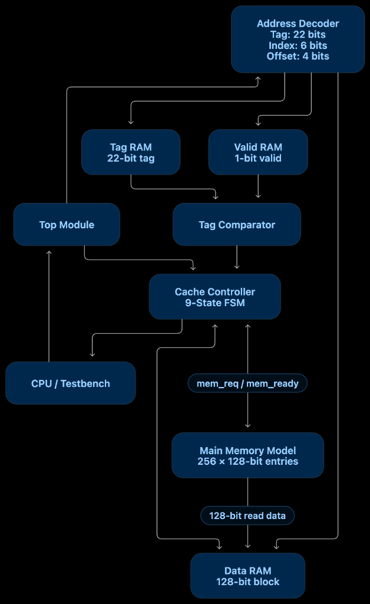
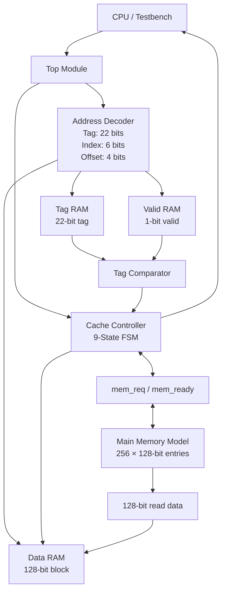

# Direct-Mapped Cache Controller Using Verilog HDL

## Team Members

| Name | Enrollment No. | Email |
|---|---|---|
| Kavya Saraswat | 2401010220 | kavya.saraswat2024@nst.rishihood.edu.in |
| Rahul Kumar Dwivedi | 2401010368 | rahul.dwivedi2024@nst.rishihood.edu.in |
| Akash Kumar Gautam | 2401010050 | akash.gautam2024@nst.rishihood.edu.in |
| Sahil Chand | 2401020104 | sahil.chand2024@nst.rishihood.edu.in |
| Harendra Chokker | 2401010179 | — |

**Programme:** B.Tech. Computer Science and Artificial Intelligence
**Institution:** Rishihood University, Sonipat, Haryana, India

---

## 1. Project Overview

This project implements a **Direct-Mapped Cache Controller** using Verilog Hardware Description Language (HDL).

The design demonstrates how a cache memory works between a CPU and main memory to reduce average memory access time. It uses a direct-mapped cache organization, where each block of main memory maps to exactly one cache line.

The cache controller manages CPU read and write requests, detects cache hits and misses, communicates with main memory, and updates cache contents when required.

### Key Features

- 1 KB direct-mapped cache.
- 64 cache lines.
- 16 bytes (128 bits) per cache line.
- 32-bit CPU address.
- 22-bit tag, 6-bit index, and 4-bit block offset.
- Write-through write policy.
- No-write-allocate policy for write misses.
- Nine-state Finite State Machine (FSM).
- Verilog-based simulation and functional verification.


### Tools Used

- **Verilog HDL:** Hardware design.
- **Icarus Verilog:** Compilation and simulation.
- **VVP:** Simulation execution.
- **Surfer:** Waveform visualization.
- **Antigravity IDE:** Code development and project management.

### Demo / Simulation Video

A walkthrough of the simulation, waveform analysis, and FSM state transitions is available here:

▶️ [Watch Demo on Google Drive](https://drive.google.com/drive/folders/130m7BiBOCHEPMafs-8uzyc5XFlS5dqOm)

## 2. Cache Architecture and Memory Organization

### 2.1 System Architecture Diagram





### 2.2 Cache Configuration

The proposed cache uses a direct-mapped organization. Each main memory block maps to exactly one cache line, determined by the index bits of the memory address.

The cache configuration is:

| Parameter | Value |
|---|---|
| Cache organization | Direct-mapped |
| Cache capacity | 1 KB |
| Number of cache lines | 64 |
| Block size | 16 bytes |
| Block width | 128 bits |
| CPU address width | 32 bits |
| Tag width | 22 bits |
| Index width | 6 bits |
| Offset width | 4 bits |

### 2.3 Address Format

The 32-bit CPU address is divided into three fields:

| Bits | Field | Width | Purpose |
|---|---|---:|---|
| [31:10] | Tag | 22 bits | Identifies the memory block |
| [9:4] | Index | 6 bits | Selects one of 64 cache lines |
| [3:0] | Offset | 4 bits | Identifies a byte position within a 16-byte block |

The address decoder extracts these three fields from the CPU address.

### 2.4 Cache Organization

The cache contains 64 lines. Each line stores:

- **Valid bit (1 bit):** Indicates whether the cache line contains valid data.
- **Tag (22 bits):** Identifies which main memory block is stored in the line.
- **Data (128 bits):** Stores one complete 16-byte memory block.

The total cache data capacity is:

64 × 128 = 8,192 bits = 1 KB.

The tag and valid-bit storage are additional metadata and are not included in the 1 KB data capacity.

### 2.5 Direct-Mapped Address Mapping

The index field selects the cache line.

For a given CPU address:

1. The index selects one of the 64 cache lines.
2. The stored tag is retrieved from that line.
3. The requested tag is compared with the stored tag.
4. The valid bit and tag comparison determine whether the access is a cache hit or miss.

Because each memory block maps to only one cache line, two different memory blocks with the same index can replace one another.

## 3. Cache Operation and Write Policies

### 3.1 Cache Read Operation

When the CPU sends a read request, the cache controller performs the following steps:

1. The CPU provides a 32-bit memory address.
2. The address decoder extracts the tag, index, and offset fields.
3. The index selects the corresponding cache line.
4. The stored tag and valid bit are retrieved.
5. The tag comparator checks whether the requested tag matches the stored tag.

**Cache Hit:**

A cache hit occurs when the valid bit is set and the requested tag matches the stored tag. The controller returns the requested block directly from the cache to the CPU.

**Cache Miss:**

A cache miss occurs when the selected cache line is invalid or its stored tag does not match the requested tag.

On a read miss:

1. The controller sends a read request to main memory.
2. Main memory returns the requested 128-bit block.
3. The controller stores the returned block in the selected cache line.
4. The corresponding tag is updated.
5. The valid bit is set to 1.
6. The requested data is returned to the CPU.

### 3.2 Write-Through Policy

The design implements a write-through policy.

Whenever the CPU performs a write operation, the updated data is sent to main memory.

For a write hit:
- Main memory is updated.
- The corresponding cache line is also updated.
- The cache and main memory therefore contain the updated block.

### 3.3 No-Write-Allocate Policy

The design uses a no-write-allocate policy for write misses.

When the CPU writes to a block that is not present in the cache:

- The write request is sent directly to main memory.
- The cache line is not allocated or refilled.
- The valid bit, tag, and cached data are not modified for that write miss.

If the CPU subsequently reads the same block, it results in a cache miss and the block is fetched from main memory.

### 3.4 Cache Hit Detection

The cache comparator generates a cache hit signal using the following condition:

cache_hit = valid_bit AND (requested_tag == stored_tag)

A cache hit is possible only when the selected cache line is valid and its stored tag matches the requested tag.

## 4. Finite State Machine (FSM)

### 4.1 Overview

The cache controller uses a Finite State Machine (FSM) consisting of nine states. The FSM controls the sequence of operations required to process CPU read and write requests.

The controller uses a 4-bit state register to represent the nine states.

### 4.2 FSM State Description

| State | Encoding | Description |
|---|---:|---|
| IDLE | 0 | Waits for a CPU request |
| LOOKUP | 1 | Allows cache RAMs to read the selected cache line |
| CHECK | 2 | Checks the valid bit and compares the requested and stored tags |
| READ_REQ | 3 | Issues a read request to main memory |
| READ_WAIT | 4 | Waits for main memory to complete the read |
| REFILL | 5 | Writes the returned block, tag, and valid bit into the cache |
| WRITE_REQ | 6 | Issues a write request to main memory and updates cache data on a write hit |
| WRITE_WAIT | 7 | Waits for main memory to complete the write |
| COMPLETE | 8 | Signals completion to the CPU and returns read data when applicable |

### 4.3 State Transitions

The FSM follows these transitions:

**Read Hit:**

IDLE → LOOKUP → CHECK → COMPLETE → IDLE

When the requested block is present in the cache and its tag matches, the controller returns the cached data without accessing main memory.

**Read Miss:**

IDLE → LOOKUP → CHECK → READ_REQ → READ_WAIT → REFILL → COMPLETE → IDLE

When a read miss occurs, the controller fetches the block from main memory and stores it in the cache before completing the request.

**Write Hit:**

IDLE → LOOKUP → CHECK → WRITE_REQ → WRITE_WAIT → COMPLETE → IDLE

The controller updates the cache data and sends the write request to main memory.

**Write Miss:**

IDLE → LOOKUP → CHECK → WRITE_REQ → WRITE_WAIT → COMPLETE → IDLE

The controller writes directly to main memory without allocating a new cache line.

### 4.4 FSM Control Signals

The FSM generates control signals to coordinate cache and memory operations.

| Control Signal | Function |
|---|---|
| tag_we | Enables writing the tag RAM |
| valid_we | Enables updating the valid-bit RAM |
| data_we | Enables writing the cache data RAM |
| valid_in | Supplies the valid bit value |
| mem_req | Initiates a main memory request |
| mem_write_en | Selects memory read or write operation |
| cpu_ready | Indicates completion of the CPU request |

### 4.5 FSM Design Benefits

- Separates cache lookup, memory access, and completion into distinct states.
- Makes cache hit and miss handling easier to manage.
- Provides clear control over cache refill operations.
- Supports write-through and no-write-allocate policies.
- Simplifies the verification of individual cache operations.

## 5. Verilog Module Description

The project is divided into multiple Verilog modules to maintain modularity, readability, and ease of verification.

### 5.1 Address Decoder (`address_decoder.v`)

Extracts the tag, index, and offset fields from the 32-bit CPU address.

### 5.2 Cache Tag RAM (`cache_tag_ram.v`)

Stores the 22-bit tag associated with each of the 64 cache lines. Supports synchronous read and write operations.

### 5.3 Cache Valid RAM (`cache_valid_ram.v`)

Maintains one valid bit for each cache line. All valid bits are cleared during reset.

### 5.4 Cache Data RAM (`cache_data_ram.v`)

Stores 128-bit data blocks for all 64 cache lines. Supports synchronous read and write operations.

### 5.5 Tag Comparator (`tag_comparator.v`)

Compares the requested tag with the stored tag. Generates a cache hit signal only when the valid bit is set and both tags match.

### 5.6 Main Memory (`main_memory.v`)

Models a behavioral main memory containing 256 blocks of 128 bits each. Supports block-level read and write operations and generates a ready signal when an operation completes.

### 5.7 Cache Controller (`cache_controller.v`)

Implements the nine-state FSM. Coordinates CPU requests, cache lookups, hit/miss detection, memory transactions, cache refills, and write operations.

### 5.8 Top Module (`top_module.v`)

Connects the cache controller, address decoder, tag RAM, valid RAM, data RAM, tag comparator, and main memory to form the complete cache system.

### 5.9 Testbench (`cache_tb.v`)

Provides clock and reset signals, generates CPU read and write requests, monitors outputs, checks expected results, counts memory requests, and generates waveform data for verification.

## 6. Project Directory Structure

The project is organized into the following directories:

```text
Direct-Mapped-Cache-Project/
│
├── src/
│   ├── address_decoder.v
│   ├── cache_tag_ram.v
│   ├── cache_valid_ram.v
│   ├── cache_data_ram.v
│   ├── tag_comparator.v
│   ├── main_memory.v
│   ├── cache_controller.v
│   └── top_module.v
│
├── testbench/
│   └── cache_tb.v
│
├── simulation/
│   ├── cache_sim
│   └── cache_waveform.vcd
│
├── documentation/
│   ├── README.md
│   ├── architecture_diagram.png
│   └── Cache_Controller_IEEE_Paper.docx
│
└── report/
```

## 7. Simulation and Verification

### 7.1 Simulation Environment

The design was developed and simulated using the following tools:

- Icarus Verilog for RTL compilation.
- VVP for executing the compiled simulation.
- Surfer for viewing simulation waveforms.
- Verilog testbench for generating input stimuli and checking outputs.

### 7.2 Compilation

The Verilog source files and testbench are compiled using Icarus Verilog.

```bash
iverilog -g2012 -o simulation/cache_sim \
src/address_decoder.v \
src/cache_tag_ram.v \
src/cache_valid_ram.v \
src/cache_data_ram.v \
src/tag_comparator.v \
src/main_memory.v \
src/cache_controller.v \
src/top_module.v \
testbench/cache_tb.v
```

### 7.3 Running the Simulation

The compiled simulation is executed using:

```bash
vvp simulation/cache_sim
```

The testbench generates CPU requests, monitors the outputs, checks expected data values, and counts main memory requests.

### 7.4 Functional Test Scenarios

The following scenarios were verified using the Verilog testbench:

| Test | Scenario | Expected behavior |
|---|---|---|
| 1 | Read miss at `0x10` | Fetch block from memory and refill cache |
| 2 | Read hit at `0x10` | Return data from cache |
| 3 | Write hit at `0x10` | Update cache and main memory |
| 4 | Read after write hit | Return updated cached data |
| 5 | Write miss at `0x20` | Write directly to main memory |
| 6 | Read after write miss | Fetch updated block from main memory |
| 7A | Read first block (`0x10`) | Confirm original block is present |
| 7B | Read conflicting block (`0x410`) | Cause a cache miss and replace the existing block |
| 7C | Read first block (`0x10`) again | Cause another miss and reload the evicted block |

### 7.5 Simulation Results

All the above test scenarios passed during simulation.

| Verification | Result |
|---|---|
| Read miss | PASS |
| Read hit | PASS |
| Write hit | PASS |
| Read after write | PASS |
| Write miss | PASS |
| Read after write miss | PASS |
| First block before replacement | PASS |
| Conflicting block access | PASS |
| First block after replacement | PASS |
| No-write-allocate policy | PASS |
| Total memory request count | 6 (PASS) |

The conflict test verifies direct-mapped cache replacement. Addresses `0x10` and `0x410` map to the same cache index but have different tags. Accessing the second block replaces the first block. Accessing the first block again causes a cache miss and retrieves its data from main memory.

### 7.6 Waveform Verification

The testbench generates a Value Change Dump (VCD) file:

```text
simulation/cache_waveform.vcd
```

The waveform can be opened in Surfer to observe:

- Clock and reset signals.
- CPU request and ready signals.
- FSM state transitions.
- Cache hit and valid-bit signals.
- Cache tag, valid, and data write enables.
- Main memory request and ready signals.

Waveform inspection helps verify the timing and sequence of cache and memory operations.

## 8. Design Limitations and Assumptions

The current implementation is a simplified behavioral model of a direct-mapped cache controller. The following limitations and assumptions apply:

### 8.1 Block-Based CPU Interface

The CPU interface transfers complete 128-bit cache blocks rather than individual bytes or words.

The address decoder extracts the 4-bit block offset, but the offset is not used to select individual bytes because the current interface operates on complete blocks.

### 8.2 Simplified Main Memory

The behavioral main memory contains 256 blocks, with each block storing 128 bits.

Although the memory address input is 28 bits wide, the current memory model uses only the lower 8 bits (`block_addr[7:0]`) to index its storage array. Therefore, it is a simplified memory model rather than a complete representation of the addressable memory space.

### 8.3 Memory Response Timing

The main memory model responds to a request in a single clock cycle by asserting its `ready` signal.

The controller generates a one-cycle memory request pulse. This implementation assumes immediate request acceptance and does not model variable memory latency or request backpressure.

### 8.4 Single Outstanding CPU Request

The controller handles one CPU request at a time. A new request is issued only after the previous operation completes and the controller returns to the IDLE state.

Back-to-back requests and pipelined CPU operations are not supported.

### 8.5 Cache RAM Initialization

The tag and data RAM arrays are not explicitly initialized during reset. However, all cache valid bits are cleared during reset.

Consequently, uninitialized tag and data values are ignored until a cache line is marked valid.

### 8.6 Scope of Verification

The design has been tested using directed testbench scenarios covering read hits, read misses, write hits, write misses, no-write-allocate behavior, and cache replacement.

These tests verify the selected functional scenarios but do not constitute exhaustive or  formal verification of every possible input and timing condition.
